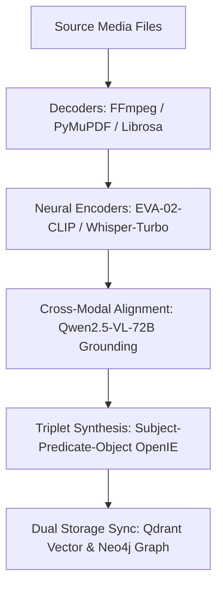

# 📥 Multimodal Knowledge Ingestion & Import Plan

A step-by-step blueprint for migrating and ingesting large-scale multimodal corpora (text documents, image libraries, audio panel discussions, and video dialogues) into the Knowledge Discovery Engine.

---

## 🎯 Phase 1: Corpus Pre-Assessment & Sanitization

1. **Modality Sorting & Validation**:
   - **Text**: Split multi-page PDFs into chapter chunks with token bounds (max 8,000 tokens per chunk).
   - **Image**: Validate minimum resolution (1024x768), normalize color space to RGB/SWIR, and convert TIFF/PNG to optimized WebP for web delivery.
   - **Audio**: Convert sample rate to 48.0 kHz 24-bit stereo or mono WAV. Strip extreme DC offsets.
   - **Video**: Transcode to MP4 (H.264 / AAC) at 30/60 fps with keyframe intervals <= 2s.

2. **Security & Privacy Pre-Check**:
   - Run Open Policy Agent (`security/opa/policy.rego`) to sanitize unmasked PII (e.g. SSNs, passwords, private customer names).
   - Checkov/Trivy secret scan on metadata attributes.

---

## ⚙️ Phase 2: Ingestion Pipeline Execution



### Batch Ingestion Script Execution

```bash
# Ingest single multimodal asset
curl -X POST "http://localhost:8000/api/v1/documents/upload" \
  -H "Authorization: Bearer <JWT_TOKEN>" \
  -F "file=@mars_perseverance_delta.jpg" \
  -F "domain=Planetary Science" \
  -F "modality=image"

# Trigger batch directory indexing
python scripts/batch_importer.py --input-dir /data/multimodal_corpus/ --parallel-workers 8
```

---

## 🔍 Phase 3: Knowledge Graph Schema Verification & Deduplication

1. **Entity Linking**:
   - Compute cosine similarity between extracted entity embeddings. If similarity > 0.88 and category matches, merge as an alias.
2. **Relation Taxonomy Mapping**:
   - Standardize open relations against core taxonomy (`analyzes_geology_of`, `causes_quantum_error_in`, `hypothesized_by_speaker`, `therapeutically_inhibits`, `regulates_motion_trajectory_of`, `threatens_infrastructure_asset`).
3. **Acyclicity & Consistency Validation**:
   - Verify that causal predicates maintain directed acyclic graph (DAG) topological constraints.

---

## 📊 Phase 4: Post-Import Benchmarking & Sign-Off

1. **Evidentiary Provenance Audit**:
   - Verify that 100% of generated triplets have at least one verified grounded evidence citation (bounding box, audio timestamp span, or document page).
2. **Benchmark Evaluation**:
   - Run automated evaluation suite against VisDial and SciCo ground-truth controls to ensure F1 >= 93.5%.
